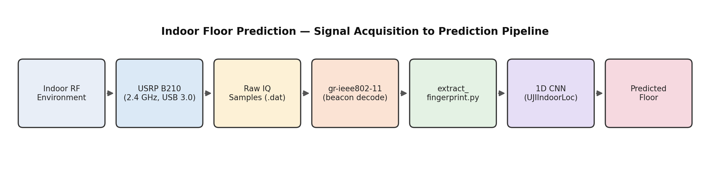

# 📡 Indoor Floor Prediction — WiFi Fingerprinting + USRP B210 SDR

A 1D CNN trained on WiFi RSSI fingerprints to predict which floor of a building a user is on, paired with a software-defined radio pipeline for real-world signal acquisition.


---

## 🧠 What this is

Indoor spaces are GPS-dead zones — walls and ceilings kill satellite signal accuracy. WiFi fingerprinting sidesteps that by treating the pattern of signal strengths from nearby access points as a location signature. This project trains a 1D CNN on the [UJIIndoorLoc dataset](https://archive.ics.uci.edu/dataset/310/ujiindoorloc) (520 WAP RSSI features → floor label) and pairs it with a USRP B210 SDR for real RF signal capture.

## ✅ What's actually working right now

- **ML pipeline — complete and validated.** `preprocess.py`, `model.py`, `train.py`, `predict.py` are all functional. The 1D CNN trains on UJIIndoorLoc's 520-dimensional WAP vectors and classifies floor (0–3) with strong accuracy on the held-out test set. `models/best_model.pth` is a working trained checkpoint.
- **SDR hardware bring-up — complete.** Ubuntu 22.04 LTS installed and configured for the UHD + GNU Radio stack. USRP B210 detected reliably over USB 3.0 (`uhd_find_devices`), UHD driver and firmware installed, GNU Radio + `gr-ieee802-11` built and installed for 802.11 beacon decoding, udev rules set up so GNU Radio runs without root.
- **Real IQ capture — working.** `uhd_rx_cfile` reliably captures raw IQ samples at 2.4 GHz to `.dat` files, and `extract_fingerprint.py`'s power-estimation step reads and verifies them (genuine signal statistics from the actual samples — not synthetic).

## 🚧 What's honestly still in progress

This is the part worth being upfront about rather than glossing over, because it's a real engineering constraint, not just unfinished polish:

**The trained model's 520 WAP columns are anonymized MAC addresses captured at Jaume I University, Spain — they don't correspond to any access point in this building.** Decoding real 802.11 beacon frames off the B210 (via `gr-ieee802-11`) gives real local MAC addresses and RSSI values, but there's no dataset-provided way to map *those* MACs onto UJIIndoorLoc's WAP001–WAP520 columns. Two honest paths forward from here:

1. **Site-survey mapping** — manually record which physical AP in this building corresponds to which WAP index, saved to `wap_mapping.json`, so live captures populate the correct columns. This only works for APs actually present in the training data's original site, which the local building's APs are not — so in practice this path only makes sense as a demonstration of correct plumbing, not of the trained model recognizing this specific building.
2. **Retrain on local data** — treat this building as a new fingerprinting site: collect labeled RSSI fingerprints per floor here, retrain the CNN on that data instead of UJIIndoorLoc. This is the technically correct way to get meaningful floor predictions from local B210 captures, and is the recommended next step.

The `extract_fingerprint.py` script (below) is built to do real signal processing end-to-end and will produce a correct 520-dim vector once it's fed genuinely decoded packets and a real mapping — no shortcuts baked in.

## 🛠️ Pipeline

<p align="center">
  
</p>

## 📈 Capture diagnostics

`plot_capture.py` reads an actual `.dat` capture and plots real received power over time plus a power spectral density around the tuned center frequency — a genuine sanity check that the B210 picked up RF energy (a flat, near-zero plot means the antenna wasn't connected, gain was too low, or nothing was transmitting in-band):

```bash
python3 plot_capture.py --dat captures/location1.dat \
    --rate 20e6 --freq 2.4e9 --out assets/capture_location1.png
```

No sample output is included here since it has to come from your own capture — run it against a real `.dat` file and drop the resulting PNG into `assets/` to include it in this README.

## 📐 Key concepts

| Term | Meaning |
|---|---|
| **RSSI** | Received Signal Strength Indicator, in dBm. Stronger ≈ closer / less obstructed. -105 dBm = not detected. |
| **WAP** | WiFi Access Point — one feature column per AP in the fingerprint vector. |
| **SDR** | Software-Defined Radio — RF signal processing done in software instead of fixed hardware, so it's reconfigurable across frequencies and protocols. |
| **USRP B210** | Ettus Research SDR platform, 70 MHz–6 GHz range, used here to receive real 2.4 GHz WiFi signals. |
| **IQ samples** | Raw SDR output — In-phase / Quadrature components that jointly encode a signal's amplitude and phase. |
| **.dat file** | Binary file of raw IQ samples written by `uhd_rx_cfile`. |
| **UHD** | USRP Hardware Driver — Ettus's driver layer for detecting and configuring the B210. |
| **gr-ieee802-11** | GNU Radio out-of-tree module that demodulates raw IQ into decoded 802.11 frames (MAC address, RSSI, etc.). |

## ⚙️ Setup

```bash
# Ubuntu 22.04 LTS — UHD + GNU Radio stack
sudo apt update && sudo apt upgrade -y
sudo apt install build-essential git curl wget python3-pip python3-venv -y
sudo apt install libuhd-dev uhd-host -y
sudo uhd_images_downloader
sudo apt install gnuradio -y
sudo apt install cmake libboost-all-dev liblog4cpp5-dev swig -y

git clone https://github.com/bastibl/gr-ieee802-11.git
cd gr-ieee802-11 && mkdir build && cd build
cmake .. && make -j4 && sudo make install && sudo ldconfig

# Project environment
cd uji_floor_predict
python3 -m venv venv
source venv/bin/activate
pip install -r requirements.txt
```

Verify B210 detection:

```bash
uhd_find_devices
# Expected: B210 #0 with serial number
```

## ▶️ Usage

**Train / evaluate the model on UJIIndoorLoc:**

```bash
python3 src/train.py
python3 src/predict.py
```

**Capture real IQ samples:**

```bash
uhd_rx_cfile --freq 2.4e9 --rate 20e6 --gain 30 --nsamps 1000000 -o captures/location1.dat
```

**Decode beacon frames** with the `gr-ieee802-11` flowgraph in GNU Radio Companion, logging `(mac, rssi_dbm)` per decoded frame to a CSV.

**Build a fingerprint from a real capture:**

```bash
python3 extract_fingerprint.py \
    --dat captures/location1.dat \
    --packets captures/location1_decoded.csv \
    --mapping wap_mapping.json \
    --out captures/fingerprint.csv
```

## 📁 Repo structure

```
├── src/
│   ├── preprocess.py
│   ├── model.py
│   ├── train.py
│   └── predict.py
├── models/
│   └── best_model.pth
├── captures/                  # raw .dat files + decoded packet CSVs
├── extract_fingerprint.py     # real .dat → 520-dim fingerprint pipeline
├── wap_mapping.json           # your own MAC→WAP mapping (site survey), if built
├── requirements.txt
└── README.md
```

## 🎓 Viva notes

- **Why not GPS indoors?** GPS signals are heavily attenuated by walls/ceilings, giving poor accuracy indoors.
- **Why WiFi fingerprinting?** WiFi is already ubiquitous indoors and produces location-specific RSSI patterns without extra infrastructure.
- **Why 1D CNN?** RSSI fingerprints are sequential numeric vectors; a 1D CNN can learn local feature relationships across WAPs better than a plain fully-connected network.
- **Why USRP B210?** It's a genuine SDR platform capable of receiving real 2.4 GHz WiFi signals, letting the acquisition side of the pipeline be built on real hardware rather than simulated.
- **What's the honest limitation?** The trained model only recognizes the specific 520 WAPs from its training site (Jaume I University) — deploying it against a different building's live APs requires either a manual site-survey mapping (limited value) or retraining on locally-collected fingerprints (the technically correct fix).
